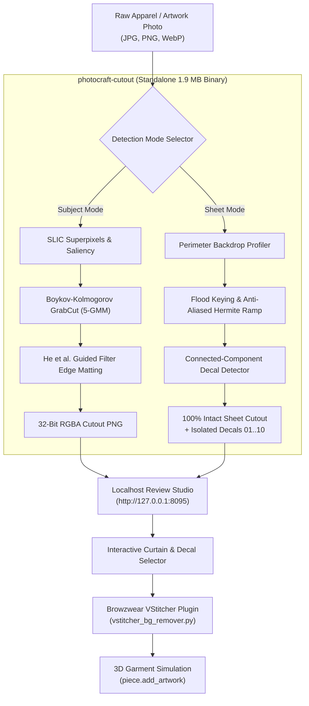

# PhotoCraft — Background Removal & Artwork Placement

> High-speed, non-neural background removal engine (pure Rust) and interactive localhost inspection studio 3D garment artwork placement.

---

## ⚡ Highlights

- **Ultra-Compact Standalone Binary (`photocraft-cutout`):** Dedicated background removal binary stripped of all UI, PSD, EXR, and CMS bloat. **1.9 MB total size** (96% footprint reduction vs 47 MB full engine), $<30\text{ms}$ sheet latency, zero Python/PyTorch dependencies.
- **Dual-Engine Detection:**
  - **Mode 1 (`Single Subject`):** Classical GrabCut with SLIC superpixels, boundary connectivity saliency, and He et al. Guided Image Filter edge matting for apparel packshots (hoodies, sneakers, tees).
  - **Mode 2 (`Artwork Sheet / Gang Sheet`):** Adaptive perimeter cyclorama profiler designed for multi-logo grids (e.g. 10 chameleon logos), retaining 100% of fine wireframe line-art, low-contrast marks, and disconnected elements without clipping.
- **Decal Piece Isolator:** Automatic bounding-box cluster detection dividing gang sheets into individual decals (`01` through `10`) with targeted VStitcher placement code.
- **Localhost Testing Studio (`:8095`):** Subpixel curtain comparison, 4-tier fringe backdrop test (Dark Grid, Light Grid, Pitch Black, Fabric Heather Grey), zoom loupe ($1\times, 2\times, 4\times$), and real-time VStitcher script generator.
- **Browzwear VStitcher Open Platform Bridge:** Standalone Python script (`vstitcher_bg_remover.py`) invoking `photocraft-cutout` directly and placing artwork onto 3D garment pattern pieces (`Front_Body`, `Left_Chest`, etc.).

---

## 🏛️ Architecture



---

## 📂 Repository Structure

```
.
├── engine/                       # Pure Rust PhotoCraft engine source
│   ├── apps/photocraft-cutout/   # Ultra-lean 1.9 MB standalone cutout binary (NEW)
│   ├── apps/photocraft-cli/      # Full CLI runner (47 MB)
│   ├── crates/algo/              # GrabCut, SLIC, GMM, Guided Filter matting
│   └── Cargo.toml                # Workspace manifest
├── studio/                       # Localhost interactive inspection web app
│   ├── server.py                 # HTTP daemon & photocraft-cutout bridge (Port 8095)
│   ├── run_studio.sh             # Studio launch script
│   ├── web/index.html            # Sleek Slate studio UI with Split Curtain
│   ├── samples/                  # Test fashion presets & chameleon logo sheet
│   └── output/                   # Pre-computed transparent cutouts & individual decals
├── vstitcher_plugin/             # Standalone Browzwear VStitcher Python bridge
│   └── vstitcher_bg_remover.py
└── README.md
```

---

## 🚀 Quickstart

### 1. Build the Standalone Cutout Binary (1.9 MB)

```bash
cd engine
cargo build --release -p photocraft-cutout
strip target/release/photocraft-cutout
```

The compiled binary will be placed at `engine/target/release/photocraft-cutout`.

### 2. Standalone CLI Usage

**Single Garment Packshot:**
```bash
./engine/target/release/photocraft-cutout input_garment.jpg -o cutout.png --mode subject --refine
```

**Artwork Gang Sheet (All 10 Logos 100% Intact):**
```bash
./engine/target/release/photocraft-cutout samples/chameleon_logos.png -o all_logos.png --mode sheet --json
```

**Isolate Single Decal (e.g. Logo 07):**
```bash
./engine/target/release/photocraft-cutout samples/chameleon_logos.png -o logo_07.png --mode sheet --decal 7
```

### 3. Run the Localhost Studio

```bash
cd studio
python3 server.py
```

Open `http://127.0.0.1:8095` in your browser to inspect cutouts, test backdrops, and pick individual decals.
```

**Artwork Gang Sheet (All Logos Intact):**
```bash
python3 vstitcher_plugin/vstitcher_bg_remover.py samples/chameleon_logos.png --mode sheet -o all_logos.png
```

**Isolate Single Decal (e.g. Logo 06):**
```bash
python3 vstitcher_plugin/vstitcher_bg_remover.py samples/chameleon_logos.png --mode sheet --decal 6 --piece Left_Chest
```

---

## 🧵 Browzwear VStitcher Integration

Inside Browzwear VStitcher's Python environment:

```python
import browzwear as bw
from vstitcher_plugin.vstitcher_bg_remover import remove_background

# 1. Strip background via PhotoCraft
cutout_path = remove_background("assets/chameleon_logos.png", mode="sheet", decal_index=6)

# 2. Place onto pattern piece
garment = bw.get_active_garment()
piece = garment.get_piece("Left_Chest")
artwork = piece.add_artwork(file_path=cutout_path, x_pos=150.0, y_pos=200.0)
artwork.set_scale(1.0)
if hasattr(bw, "MaterialType"):
    artwork.set_material_type(bw.MaterialType.EMBROIDERY)
```

---

## 📜 License

- Engine: Dual-licensed under [MIT](engine/LICENSE-MIT) and [Apache 2.0](engine/LICENSE-APACHE).
- Studio & VStitcher Plugin: MIT License.
